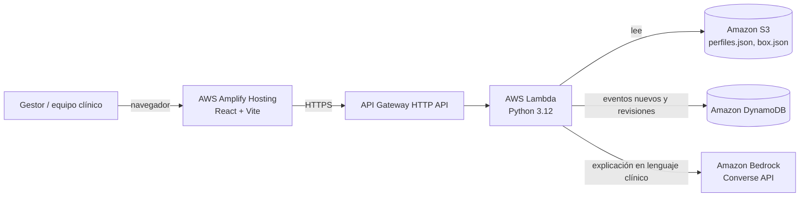

# Arquitectura — Ambulatorio Dinámico HLF

## Flujo
1. **Llega un evento clínico** (urgencia, hospitalización, examen alterado…) → `POST /eventos` → se guarda en DynamoDB.
2. **La Lambda recalcula** el puntaje de toda la especialidad con reglas explicables (`puntaje.py`) en milisegundos. KPI del hospital: reevaluación < 72 h; acá es < 1 s.
3. **El front reordena la lista** y muestra por qué el paciente subió (desglose de puntos).
4. **Bedrock redacta la explicación** en lenguaje clínico, usando SOLO las razones calculadas. Nunca decide la prioridad.
5. **El equipo clínico confirma o ajusta** (con motivo obligatorio) → trazabilidad en DynamoDB.

## Decisiones de diseño
| Decisión | Por qué |
|---|---|
| Puntaje por reglas, no por LLM | Explicable, auditable, reproducible y sin alucinaciones en una decisión clínica |
| LLM solo explica | Cumple el principio del hospital: "la herramienta propone y explica; el equipo clínico decide" |
| Serverless (Lambda + DynamoDB on-demand) | Costo cercano a cero en reposo; escala sola a toda la Red Sur Oriente |
| Datos en S3 privado y cifrado, sin RUT ni nombres | Privacidad; los datos no salen de la cuenta AWS del hospital |
| Fallback de explicación por plantilla | El sistema sigue funcionando si Bedrock no está disponible |
| Inasistencias no bajan la prioridad clínica | Evita castigar a los más vulnerables; se gestionan con confirmación telefónica |

## Escalabilidad
- Misma lógica para cualquier especialidad (incluida oftalmología) y cualquier hospital con registro clínico electrónico.
- Agregar una fuente de eventos = escribir en `POST /eventos` (integración futura con RCE / SIDRA).
- Pesos configurables para calibrar con el equipo clínico (meta de concordancia κ ≥ 0,70).
